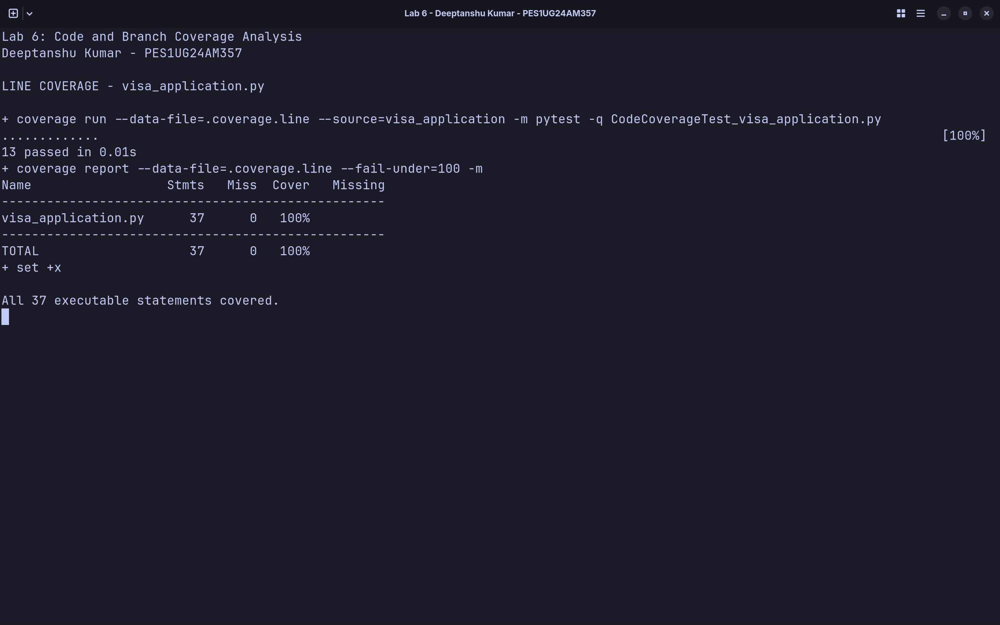

# Lab 6: Code and Branch Coverage Analysis

**Name:** Deeptanshu Kumar  
**SRN:** PES1UG24AM357  
**Assigned application:** `visa_application.py`

The application calculates visa fees, checks documents, and determines the
application status. The original application and starter tests are unchanged.
All assignment work is in this `Lab 6` directory.

## Setup

From the repository root:

```bash
python3 -m venv .venv
source .venv/bin/activate
python -m pip install -r "Lab 6/requirements.txt"
cd "Lab 6"
```

## Initial coverage

The two starter tests passed. Their line coverage was 14/37 statements
(37.84%). With branch measurement enabled, they covered 6/26 branch outcomes
(23.08%). Coverage.py's combined statement-and-branch result was 20/63
(31.75%). The terminal rounds these results to 38% and 32%, respectively.

The starter suite missed validation exceptions, extra-entry charges, renewal
checks, missing photos, and the entire application-status function. Initial
results are recorded here without screenshots, as the handout requests
screenshots only after reaching at least 90% coverage.

## Code coverage

`CodeCoverageTest_visa_application.py` contains 13 tests. They cover both
validation exceptions, free entries, the group A allowance, normal and express
fees, express bulk surcharges, document checks, and all three status results.

```bash
coverage run --data-file=.coverage.line --source=visa_application -m pytest -q CodeCoverageTest_visa_application.py
coverage report --data-file=.coverage.line --fail-under=100 -m
```

**Result:** 13 passed; 37/37 executable statements covered (100%).



Line coverage checks whether each executable statement ran. It does not prove
every decision outcome was tested. Measuring this same suite with `--branch`
leaves the normal-speed bulk-fee path (`21 -> 23`) untested, despite 100% line
coverage. This suite covers 25/26 branch outcomes (96.15%), and Coverage.py's
combined result is 62/63 (98.41%).
