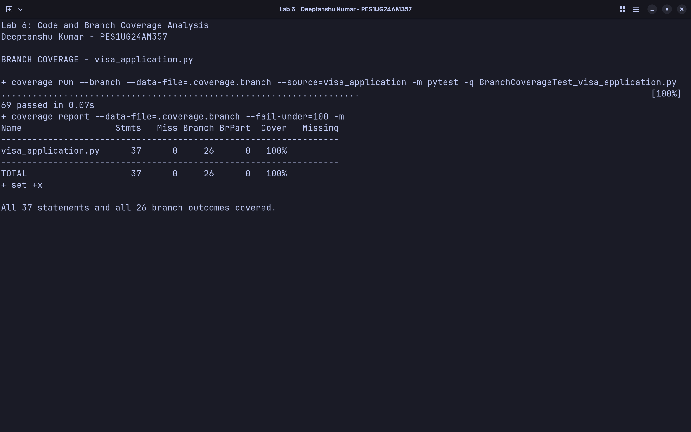

# Lab 6: Code and Branch Coverage Analysis

**Name:** Deeptanshu Kumar

**SRN:** PES1UG24AM357

**Assigned application:** `visa_application.py`

The application calculates visa fees, checks documents, and determines the
application status. The original application and starter tests are unchanged.
All assignment work is in this `Lab 6` directory.

## Setup

From the repository root:

```bash
python3 -m venv .venv
source .venv/bin/activate
python -m pip install -r "Lab 6/requirements.txt"
cd "Lab 6"
```

## Initial coverage

The two starter tests passed. Their line coverage was 14/37 statements
(37.84%). With branch measurement enabled, they covered 6/26 branch outcomes
(23.08%). Coverage.py's combined statement-and-branch result was 20/63
(31.75%). The terminal rounds these results to 38% and 32%, respectively.

The starter suite missed validation exceptions, extra-entry charges, renewal
checks, missing photos, and the entire application-status function. Initial
results are recorded here without screenshots, as the handout requests
screenshots only after reaching at least 90% coverage.

## Code coverage

`CodeCoverageTest_visa_application.py` contains 13 tests. They cover both
validation exceptions, free entries, the group A allowance, normal and express
fees, express bulk surcharges, document checks, and all three status results.

```bash
coverage run --data-file=.coverage.line --source=visa_application -m pytest -q CodeCoverageTest_visa_application.py
coverage report --data-file=.coverage.line --fail-under=100 -m
```

**Result:** 13 passed; 37/37 executable statements covered (100%).


Line coverage checks whether each executable statement ran. It does not prove
every decision outcome was tested. Measuring this same suite with `--branch`
leaves the normal-speed bulk-fee path (`21 -> 23`) untested, despite 100% line
coverage. This suite covers 25/26 branch outcomes (96.15%), and Coverage.py's
combined result is 62/63 (98.41%).

## Branch coverage

`BranchCoverageTest_visa_application.py` contains 69 independently runnable
test cases: 3 validation cases, 29 fee cases, 13 document cases, and 24 status
boundary cases. Expected fees and status boundaries are specified in the test
data rather than calculated by calling another application function.

```bash
coverage run --branch --data-file=.coverage.branch --source=visa_application -m pytest -q BranchCoverageTest_visa_application.py
coverage report --data-file=.coverage.branch --fail-under=100 -m
```

**Result:** 69 passed; 37/37 statements and 26/26 branch outcomes covered
(100% line coverage, 100% branch coverage, 100% combined coverage).



The normal-speed bulk case completes the previously missing `21 -> 23` branch.
Five extra entries are tested at the base rate, and six at the surcharge rate,
for normal and express processing. Group A cases exercise both eligible visa
types and the student exception. Renewal and new-application tests check both
boolean results and the one-form, three-form, and two-photo boundaries.
Status tests check just below, at, and above both thresholds for all four
speed/season combinations, including the existing function's negative-day
thresholds for express, off-peak applications.

The `Cover` column from a `--branch` run combines statements and branch
outcomes. The separate branch result above is 26/26; it is not inferred merely
from a rounded combined percentage. Measurements target only the unchanged
`visa_application` module. No coverage exclusions or mocks are used.

Coverage.py measures control-flow branches, not all combinations of conditions
or every possible path. The group A/student cases additionally exercise each
outcome of the compound condition. High coverage alone does not prove the
absence of defects.

## Run all tests

```bash
python -m pytest -q
```

**Result:** 84 passed: 2 starter tests, 13 code coverage tests, and 69 branch
coverage cases. `pytest.ini` includes the handout's required test filenames in
test discovery. The two separate coverage commands above keep the measurements
independent.

## Evidence and commits

Both PNGs are genuine terminal screenshots captured after reaching 100%, using
GNOME's configured full-screen shortcut, Shift+Alt+Super+S. Deeptanshu Kumar and
PES1UG24AM357 are visible in each screenshot.

The first assignment commit contains the code coverage suite and its screenshot.
The second contains the branch coverage suite and its screenshot.

Coverage reference: [Coverage.py branch coverage documentation](https://coverage.readthedocs.io/en/latest/branch.html).
